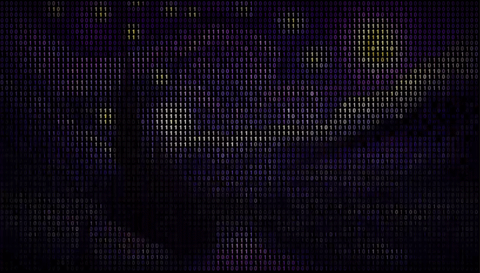
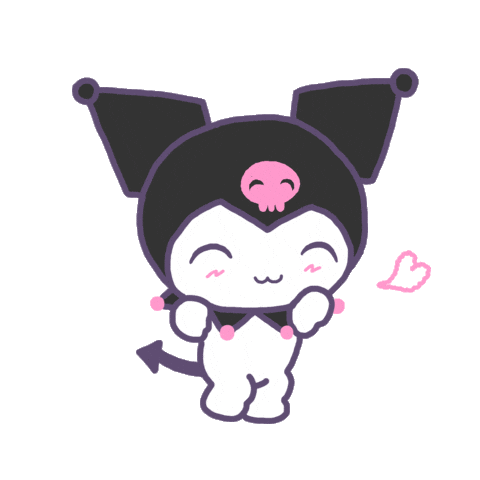
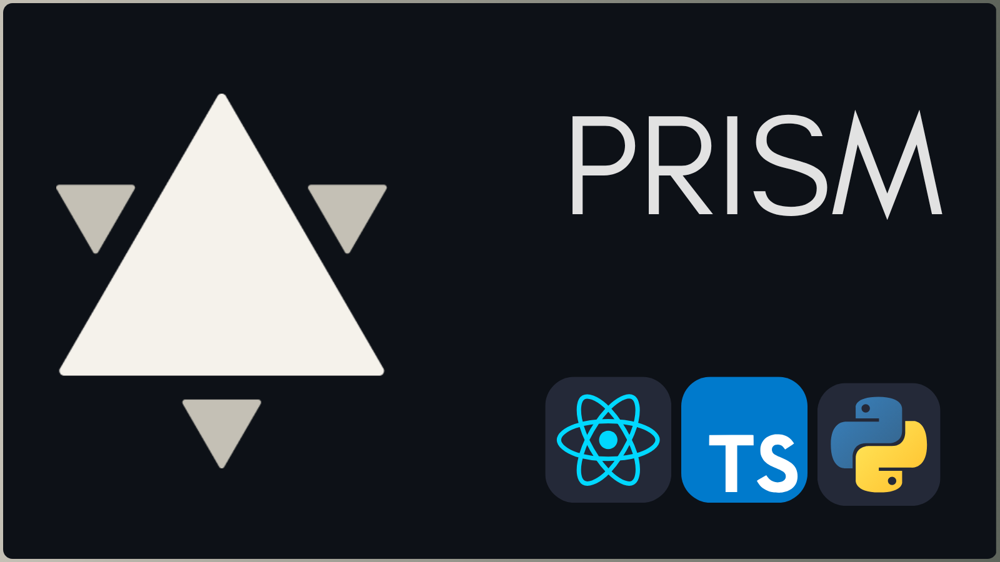
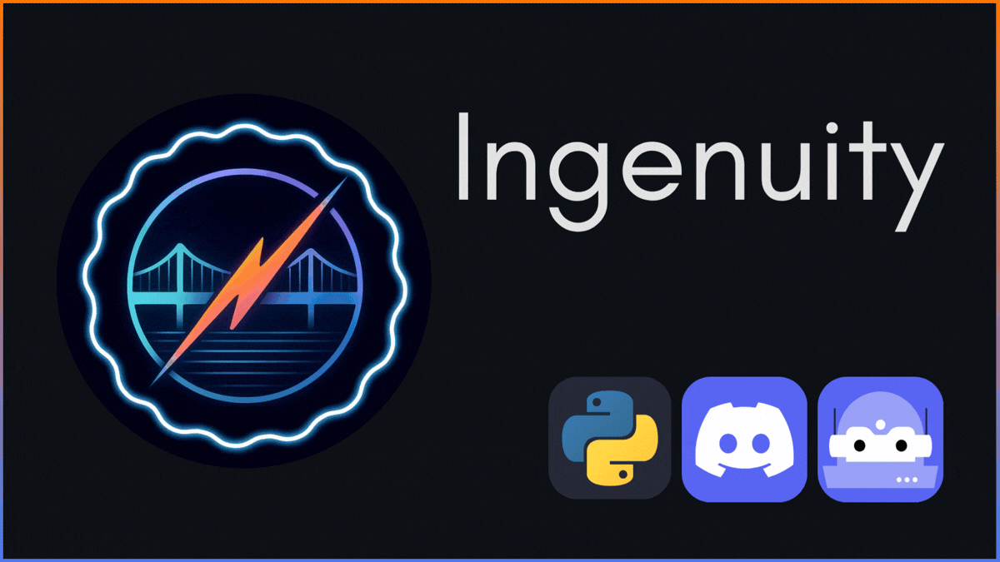
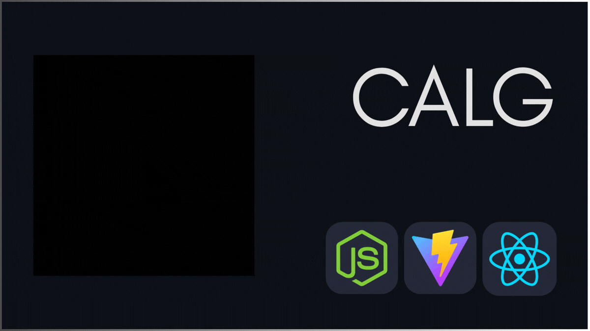
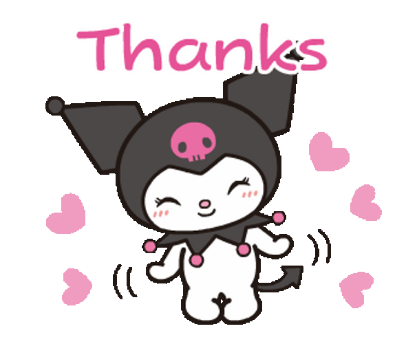

 

  

<!--  -->

<table>
<tr>

<td width="65%">

# ✦ About Me

Engineering solutions to problems that didn't exist yesterday. Automating the occasional task, and creating things that are as practical as they are fun to build. 

<td width="35%" align="center">

</tr>
</table>

  

  <h2>✦ Core Competencies</h2>
   
  

  

<h2 align="center">✦ Featured Projects</h2>

  

<!-- # ✦ GitHub Analytics

 -->

# ✦ Connect

  

<table>
<tr>
<td width="35%" align="left">
  
</td>

<td width="65%" align="center">

</td>
</tr>
</table>
