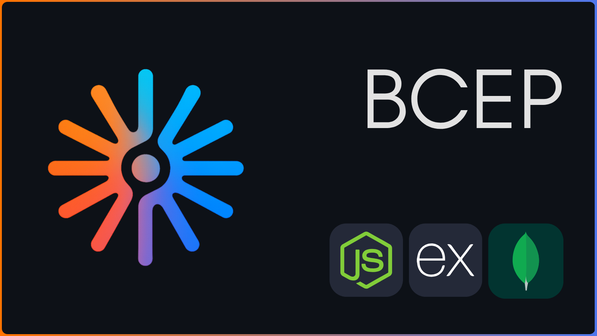
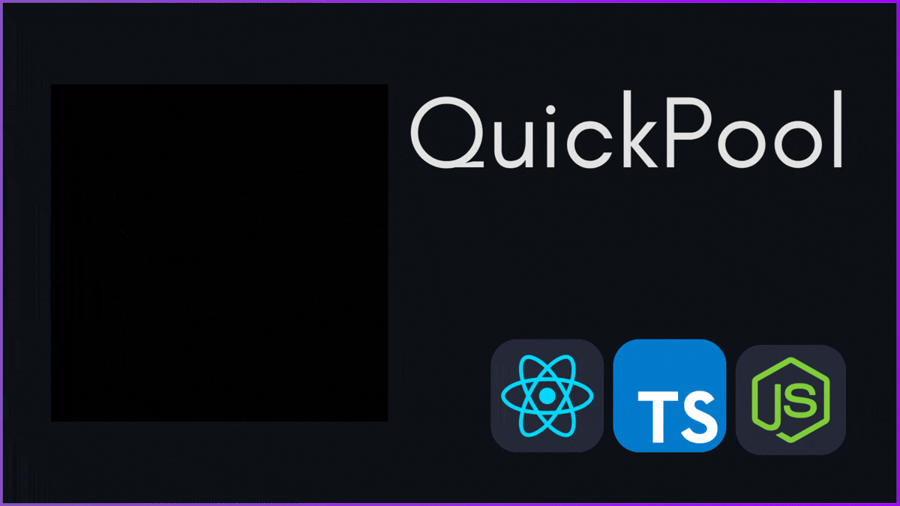
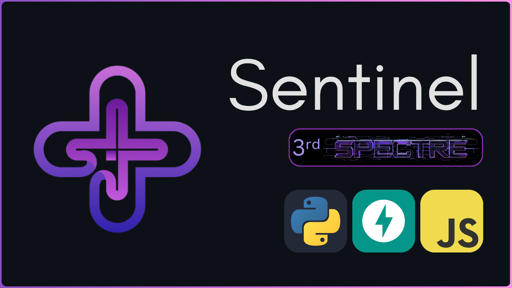
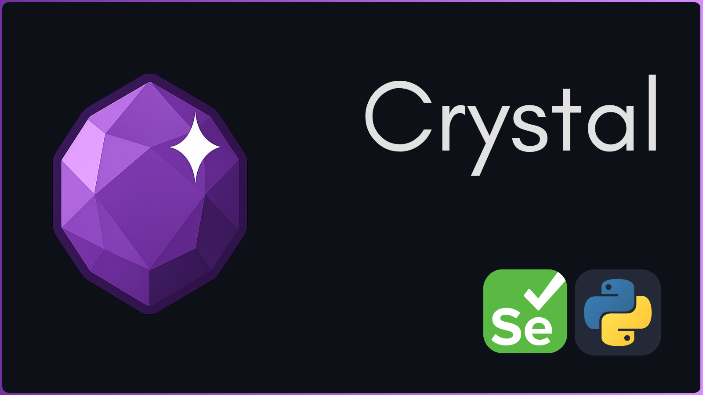

 

Building practical software, developer tools, and modern web applications with clean architecture and thoughtful design.

<table>
<tr>

<td width="65%" valign="top">

# About Me

I'm a **Computer Science student** focused on building practical software with clean architecture and scalable systems.

My interests include full-stack development, backend engineering, automation, scraping, and cloud technologies.

</td>

<td width="35%" align="center">

</td>

</tr>
</table>

# Tech Stack

### Languages

### Frontend

### Backend

### Tools & Cloud

# Featured Projects

<table>

<tr>

<td align="center">

</td>

<td align="center">

</td>

<td align="center">

</td>

</tr>

<tr>

<td align="center">

</td>

<td align="center">

</td>

<td align="center">

</td>

</tr>

<tr>

<td align="center">

</td>

<td></td>
<td></td>

</tr>

</table>

# Connect

  

